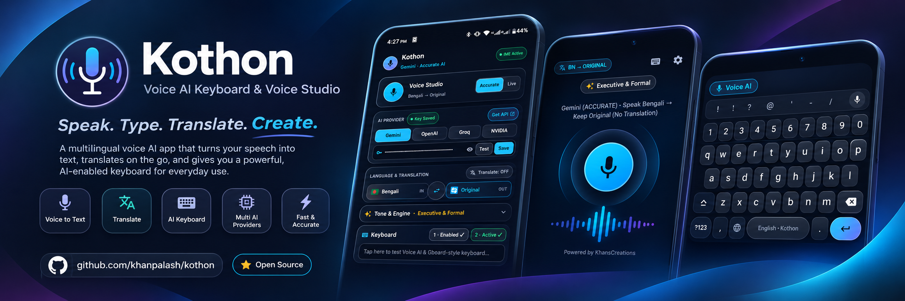
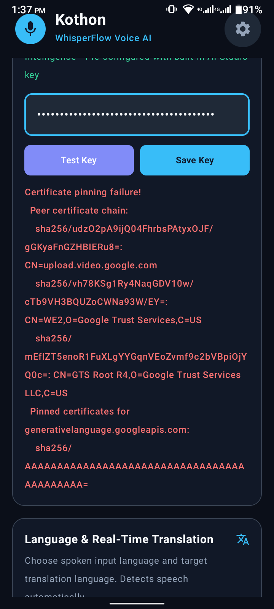
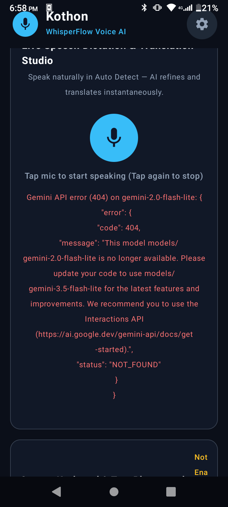

# Kothon — Voice-First Keyboard & Dictation Studio

<div align="center">



**A voice-first Android IME with real-time hardware speech-to-text and AI-powered text refinement**

[](https://developer.android.com/about/versions/14)
[](https://kotlinlang.org)
[](https://developer.android.com/jetpack/compose)
[](https://gradle.org)
[](LICENSE)

**Created by [Khan Palash](https://github.com/KhanPalash) & powered by [KhansCreations](https://khanscreations.com/)**

</div>

---

## 📥 Quick Download

<div align="center">

### 🚀 Install Release APK Directly

[](https://github.com/KhanPalash/Kothon/releases/latest/download/app-release.apk)

**Latest Release:** `app-release.apk` • **Size:** ~12 MB • **Min Android:** 7.0 (API 24)

> 💡 **Tip:** Enable "Install from unknown sources" for your browser/file manager before installing.

</div>

---

## ✨ Features

### 🎙️ Two Dictation Modes

| Mode | Description | Best For |
|------|-------------|----------|
| **ACCURATE** (default) | Record audio → AI transcription & refinement → insert | High accuracy, noisy environments, long-form dictation |
| **LIVE** (beta) | Real-time on-device speech recognition as you speak | Instant feedback, short messages, hands-free use |

> **Note:** LIVE mode is behind a feature flag (`live_dictation_enabled`, default **OFF**). Enable in **Settings → Live Dictation (Beta)**.

### 🌍 Multilingual Support
- **40+ languages** with native script display and country flags
- Source language: auto-detect or explicit selection
- Target language: translate to any supported language or keep original
- Bangla (বাংলা) as primary market with `bn-BD` / `bn-IN` support

### 🤖 AI Refinement Pipeline
- **Text-only refinement** — bypasses audio upload, ~200-400ms latency
- Multiple providers: **Gemini** (built-in), Groq, OpenAI, NVIDIA
- Per-provider API key isolation (no cross-provider leakage)
- Configurable: tone, filler removal, grammar fix, translation

### 🛡️ Privacy & Security First
- **Password field detection** — voice completely disabled in password fields (no recognizer, no cloud call)
- **Android KeyStore AES-256-GCM** encryption for API keys at rest
- **Excluded from cloud backup** — `kothon_prefs.xml` never leaves device
- **Zero transcript logging** — nothing sensitive in logcat

### ⌨️ IME + In-App Studio
- **KeyboardService** — full InputMethodService with Compose UI
- **MainActivity** — dictation studio for testing, note-taking, sharing
- Shared `LiveDictationController` ensures identical behavior in both

### 🔧 Advanced Controls
- Auto-refine toggle (instant polish vs. raw + manual Refine button)
- Prefer on-device recognition (download language models via Settings)
- Wi-Fi-only model download
- Session timeout (default 5 min)
- Undo AI refinement (revert to raw transcript)
- Tone presets: Professional, Executive, Casual, Concise, Bullets

---

## 📱 Screenshots

<div align="center">
<table>
<tr>
<td align="center"><br/>Dictation Studio</td>
<td align="center"><br/>Keyboard IME</td>
</tr>
</table>
</div>

---

## 🏗️ Architecture

```
Kothon (single module :app)
├── com.example                    # Android namespace (R, BuildConfig, Manifest)
│   ├── MainActivity.kt             # Compose studio screen
│   └── ui/theme/                   # Material3 dark theme (Cyan/Indigo/Amber)
│
├── com.whisperflow                # Product code
│   ├── audio/
│   │   ├── SpeechSession.kt        # Interface for testability
│   │   ├── AndroidSpeechSession.kt # SpeechRecognizer wrapper (API 31+ on-device)
│   │   ├── LiveDictationController.kt  # State machine (LISTENING→STOPPING→REFINING→DONE)
│   │   ├── LiveDictationSupport.kt # Language resolution, CJK separator, feature flag
│   │   ├── DictationEditor.kt      # IME InputConnection boundary interface
│   │   ├── ImeDictationEditor.kt   # IME implementation
│   │   ├── StudioEditorAdapter.kt  # In-memory editor for Studio
│   │   ├── DictationModels.kt      # State, session, snapshot data classes
│   │   ├── DeviceSpikeValidator.kt # API 33+ model support/download check
│   │   ├── PasswordFieldDetector.kt # Zero-tolerance password detection
│   │   ├── Recorder.kt             # MediaRecorder (AAC .m4a) for ACCURATE mode
│   │   └── PermissionHelper.kt     # Runtime mic permission
│   │
│   ├── api/
│   │   └── TranscriptionClient.kt  # HTTP providers + refineText()
│   │
│   ├── settings/
│   │   ├── KothonPreferences.kt    # SharedPreferences + KeyStore encryption
│   │   ├── KeyStoreHelper.kt       # AES-256-GCM hardware-backed
│   │   ├── SettingsActivity.kt     # Compose-based settings UI
│   │   └── SettingsScreen.kt       # Settings composables
│   │
│   ├── model/
│   │   └── Language.kt             # 40+ Language catalog with flags
│   │
│   └── ui/
│       ├── VoiceButton.kt          # Mic button with Undo/Refine chips
│       ├── StandardKeyboardView.kt # QWERTY fallback
│       ├── LanguageSelectorBottomSheet.kt
│       ├── PermissionDialog.kt
│       └── KothonComponents.kt     # Shared UI components
│
└── res/
    ├── values/strings.xml
    └── xml/ (backup_rules, data_extraction_rules, method)
```

---

## 🚀 Setup & Installation

### Prerequisites

| Requirement | Version | Notes |
|-------------|---------|-------|
| **Android Studio** | Koala (2024.1.1) or newer | Latest stable recommended |
| **JDK** | 11+ | JDK 17/21 also work |
| **Android SDK** | Platform 36 (API 36) | Required for `compileSdk = 36.1` |
| **Device** | Physical Android 7.0+ | Emulator lacks on-device SpeechRecognizer |
| **Gradle** | 9.3.1 | Wrapper auto-generated |

### Step 1: Clone Repository

```bash
git clone https://github.com/KhanPalash/Kothon.git
cd Kothon
```

### Step 2: Generate Gradle Wrapper (Required)

The wrapper JAR is not committed. Generate it once:

```bash
# Option A: Using system Gradle (if installed)
gradle wrapper --gradle-version 9.3.1

# Option B: Using Android Studio
# File → Settings → Build → Gradle → Gradle JDK → select JDK 11+
# Then: ./gradlew wrapper --gradle-version 9.3.1
```

### Step 3: Configure Local Properties

Create `local.properties` in project root:

```properties
# Linux/macOS
sdk.dir=/home/username/Android/Sdk

# Windows
sdk.dir=C:\\Users\\username\\AppData\\Local\\Android\\Sdk
```

Or set `ANDROID_HOME` environment variable.

### Step 4: Configure API Keys (Required for AI Features)

#### A. Built-in Gemini Key (Build-time via `.env`)

Create `.env` file in project root:

```bash
cp .env.example .env
```

Edit `.env`:
```properties
# Get key from: https://aistudio.google.com/apikey
GEMINI_API_KEY=your_actual_gemini_api_key_here
```

> ⚠️ **Never commit `.env`** — it's in `.gitignore`. The Secrets Gradle plugin injects this into `BuildConfig.GEMINI_API_KEY` at build time.

#### B. Per-Provider Keys (Runtime via Settings UI)

No build-time config needed. Add keys directly in the app:

1. Open **Kothon app** → Settings (gear icon)
2. Tap **API Keys** section
3. Add keys for desired providers:
   - **Groq** → `gsk_...` (get from [console.groq.com](https://console.groq.com/keys))
   - **OpenAI** → `sk-...` (get from [platform.openai.com](https://platform.openai.com/api-keys))
   - **NVIDIA** → `nvapi-...` (get from [build.nvidia.com](https://build.nvidia.com/))

Keys are encrypted with **Android KeyStore AES-256-GCM** and never leave the device.

### Step 5: Build & Install

```bash
# Debug build (for development)
./gradlew :app:assembleDebug

# Install on connected device
./gradlew :app:installDebug
```

**Output APK:** `app/build/outputs/apk/debug/app-debug.apk`

### Step 6: Enable Keyboard on Device

1. **Settings → Languages & Input → Virtual Keyboard → Manage Keyboards**
2. Enable **"Kothon Voice Keyboard"**
3. Open any text field → Tap keyboard switcher (🌐/⌨️) → Select **Kothon**
4. Tap **🎤 microphone button** to start dictation

---

## ⚙️ Configuration Guide

### Environment Variables (`.env`)

```properties
# === REQUIRED for Gemini (build-time injection) ===
GEMINI_API_KEY=your_gemini_key_from_aistudio

# === OPTIONAL: Release signing (CI/CD) ===
# KEYSTORE_PATH=/path/to/my-upload-key.jks
# STORE_PASSWORD=your_keystore_password
# KEY_PASSWORD=your_key_password
```

### In-App Settings

| Setting | Location | Description |
|---------|----------|-------------|
| **Dictation Mode** | Settings → Dictation Mode | ACCURATE / LIVE (beta) |
| **Auto-Refine** | Settings → Auto-Refine | Instant AI polish on final transcript |
| **Source Language** | Settings → Source Language | Auto-detect or specific language |
| **Target Language** | Settings → Target Language | Translate to / Keep original |
| **Live Dictation (Beta)** | Settings → Live Dictation | Enable LIVE mode + options |
| **Prefer On-Device** | Settings → Prefer On-Device | Use local SpeechRecognizer when available |
| **Wi-Fi Only Download** | Settings → Model Download | Only download models on Wi-Fi |
| **Session Timeout** | Settings → Session Timeout | Max recording duration (default 5 min) |
| **API Keys** | Settings → API Keys | Groq / OpenAI / NVIDIA keys |
| **Tone Preset** | Settings → Tone | Professional, Executive, Casual, Concise, Bullets |

### Live Dictation Setup (Beta)

```
Settings → Live Dictation (Beta) → ON
         → Dictation Mode → LIVE
         → Auto-Refine → ON/OFF
         → Prefer On-Device → ON/OFF
         → Live Language → Select language
         → Check/Download Model → Triggers system download (API 33+)
```

> **Note:** On-device models require Android 13+ (API 33). Download size ~50-100MB per language.

---

## 🔑 Getting API Keys

### 1. Google Gemini (Built-in Default)

1. Go to **[Google AI Studio](https://aistudio.google.com/apikey)**
2. Sign in with Google account
3. Click **"Create API Key"**
4. Copy key → Paste in `.env` as `GEMINI_API_KEY`
5. **Free tier:** 60 requests/min, 1,500 requests/day

### 2. Groq (Fast Inference)

1. Go to **[Groq Console](https://console.groq.com/keys)**
2. Sign up / log in
3. Create API Key
4. Add in Kothon Settings → API Keys → Groq
5. **Free tier:** 14,400 requests/day (very generous)

### 3. OpenAI

1. Go to **[OpenAI Platform](https://platform.openai.com/api-keys)**
2. Create new secret key
3. Add in Kothon Settings → API Keys → OpenAI
4. **Pay-as-you-go:** Requires billing setup

### 4. NVIDIA NIM

1. Go to **[NVIDIA Build](https://build.nvidia.com/)**
2. Get API key from your account
3. Add in Kothon Settings → API Keys → NVIDIA
4. **Free tier available** for development

---

## 🧪 Testing

```bash
# All unit tests (115+ tests, JVM + Robolectric)
./gradlew :app:testDebugUnitTest

# Specific test suites
./gradlew :app:testDebugUnitTest --tests "com.whisperflow.audio.LiveDictationControllerTest"
./gradlew :app:testDebugUnitTest --tests "com.whisperflow.KothonIntegrationTest"
./gradlew :app:testDebugUnitTest --tests "com.whisperflow.settings.KothonPreferencesTest"

# Connected device tests (requires device/emulator)
./gradlew :app:connectedDebugAndroidTest
```

**Test Coverage Includes:**
- State machine transitions (IDLE→LISTENING→STOPPING→DONE/ERROR)
- Partial/final commit, duplicate suppression, cumulative prefix stripping
- Safe replace: token/selection/cursor/code-point verification
- Undo: snapshot match, user-edit invalidation
- Password field detection (4 variants)
- Preferences round-trip & per-provider key isolation
- Language resolution (never `auto`/`original` to recognizer)
- CJK separator handling (zh/ja/ko = no space)

---

## 📦 Release Build

```bash
# Requires environment variables:
export KEYSTORE_PATH=/path/to/my-upload-key.jks
export STORE_PASSWORD=your_store_password
export KEY_PASSWORD=your_key_password

./gradlew :app:assembleRelease
```

**Output:** `app/build/outputs/apk/release/app-release.apk`

> ⚠️ **Signing configs must not be modified** — required for AI Studio installs.

### Generate Keystore (First Time)

```bash
keytool -genkey -v \
  -keystore my-upload-key.jks \
  -keyalg RSA \
  -keysize 2048 \
  -validity 10000 \
  -alias upload
```

Store `my-upload-key.jks` securely — **never commit it**.

---

## 📋 Known Limitations

| Area | Limitation |
|------|------------|
| Bangla on-device | `bn-BD`/`bn-IN` model may be unavailable on some devices; falls back to online recognizer |
| Continuous dictation | System `SpeechRecognizer` restarts on silence — brief gap (beep) between segments |
| OEM variance | Samsung/Xiaomi/OnePlus recognizer behavior differs; tested on Pixel baseline |
| Refine latency | Network-dependent (p95 < 3s typical); 15s timeout falls back to raw text |
| No mocking lib | Tests use hand-written fakes (`FakeSpeechSession`, `FakeDictationEditor`) |
| Emulator support | On-device SpeechRecognizer not available on emulator |

---

## 🗺️ Roadmap

- [x] **Phase 0:** Build env + device spike
- [x] **Phase 1:** Interfaces + live typing
- [x] **Phase 2:** Safety (password, field-switch, token)
- [x] **Phase 3:** Text-only refinement + safe replace + Undo
- [x] **Phase 4:** Studio + Settings integration
- [ ] **Phase 5:** Device matrix, beta rollout, crash/ANR monitoring
- [ ] **Phase 6:** Offline-first mode, custom vocabularies, widget

See [`new_plan.md`](new_plan.md) for detailed task breakdown.

---

## 🤝 Contributing

1. **Fork** the repository
2. **Create** feature branch: `git checkout -b feat/amazing-feature`
3. **Commit** changes: `git commit -m 'Add amazing feature'`
4. **Push** to branch: `git push origin feat/amazing-feature`
5. **Open** a Pull Request

> **Code Style:** Kotlin, Compose, Coroutines, hand-written fakes for tests. Follow existing patterns.

---

## 📄 License

```
Copyright 2024-2026 Khan Palash / KhansCreations

Licensed under the Apache License, Version 2.0 (the "License");
you may not use this file except in compliance with the License.
You may obtain a copy at http://www.apache.org/licenses/LICENSE-2.0
```

---

## 🙏 Acknowledgments

- **Android SpeechRecognizer** — on-device & cloud recognition
- **Google Gemini / Groq / OpenAI / NVIDIA** — AI refinement providers
- **Jetpack Compose** — modern declarative UI
- **Moshi / OkHttp / Coroutines** — networking & async
- **Material 3** — design system

---

<div align="center">

**Made with ❤️ by [Khan Palash](https://github.com/KhanPalash) — [KhansCreations](https://khanscreations.com/)**

⭐ **Star this repo if you find it useful!**

[](https://github.com/KhanPalash/Kothon/stargazers)
[](https://github.com/KhanPalash/Kothon/network/members)
[](https://github.com/KhanPalash/Kothon/issues)

</div>